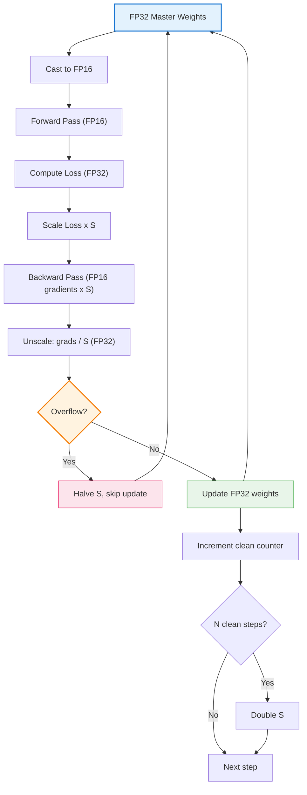
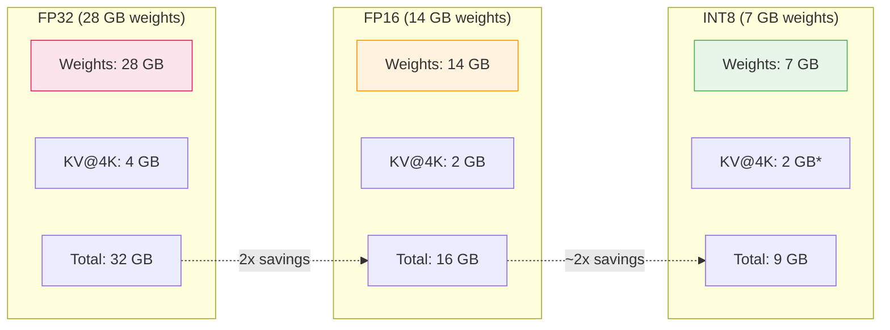
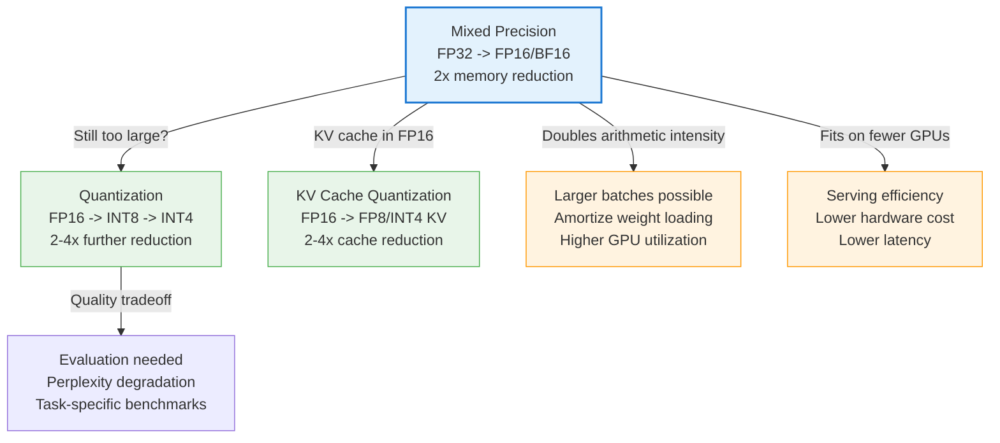

# Mixed Precision -- Deep Dive

## The Intuition

### What Problem Are We Solving?

You have a 7-billion-parameter language model and an NVIDIA A100 GPU. The model weights in FP32 occupy 28 GB. The A100 has 80 GB of HBM and can move data from memory to compute units at 2 TB/s. During autoregressive decoding (one token at a time), each generated token requires reading essentially all 28 GB of weights from memory, performing a relatively tiny amount of arithmetic, and writing a small result back. The math:

$$\text{Time per token} = \frac{28 \text{ GB}}{2000 \text{ GB/s}} = 14 \text{ ms} \approx 71 \text{ tokens/s}$$

The GPU's FP32 compute throughput is 19.5 TFLOPS. For a single-token decode step, you need roughly $2 \times 7 \times 10^9 \approx 14$ GFLOPs. At 19.5 TFLOPS, the compute takes $\sim 0.7$ ms. The GPU spends 14 ms waiting for data and 0.7 ms doing math. It is idle more than 95% of the time.

Now store those same weights in FP16: 14 GB instead of 28 GB.

$$\text{Time per token} = \frac{14 \text{ GB}}{2000 \text{ GB/s}} = 7 \text{ ms} \approx 143 \text{ tokens/s}$$

You just doubled your throughput by changing a data type. No algorithmic changes, no architectural innovations, no extra hardware. Just fewer bytes per number.

This is the core of mixed precision: neural networks do not need 32-bit precision for most operations. Cutting precision in half cuts memory in half, which directly translates to doubled throughput when you are memory-bandwidth bound -- and inference is almost always memory-bandwidth bound.

### The Key Insight

IEEE 754 floating point numbers pack three things into their bits: a sign, an exponent (determining magnitude/range), and a mantissa (determining precision within that magnitude). FP32 uses 8 exponent bits and 23 mantissa bits. You can redistribute these bits to create smaller formats:

- **FP16** uses 5 exponent bits and 10 mantissa bits. It is half the size but tops out at 65,504 and has only ~3 decimal digits of precision.
- **BF16** uses 8 exponent bits and 7 mantissa bits. Same range as FP32, even less precision than FP16, but it never overflows where FP32 does not.

The "aha" moment: neural network weights and activations cluster near zero with values rarely exceeding a few hundred. The 23 bits of mantissa precision in FP32 are overkill -- networks train through noise, dropout, and stochastic gradient descent, so they are inherently robust to small perturbations. We are paying double the memory for precision the model does not use.

But some operations genuinely need high precision: accumulating thousands of small products in a dot product, computing the denominator of softmax, tracking a running mean in normalization. Mixed precision means using low precision where safe and high precision where necessary.

### Real-World Analogy

Consider measuring lumber for a house. For cutting 2x4 studs to frame a wall, measuring to the nearest quarter-inch is plenty -- the stud finder, saw blade, and wood grain introduce more error than that. Using a micrometer for every cut would take forever with zero benefit. But for the door frame, where a gap of 1/16 inch means the door sticks, you need the precision. Mixed precision is the carpenter who uses a tape measure for the studs and a precision square for the door frame. Different precision for different tasks, chosen by what each task actually requires.

---

## The Math, Step by Step

### IEEE 754: How Computers Store Real Numbers

Every IEEE floating point number is encoded as:

$$\text{value} = (-1)^{s} \times 2^{e - \text{bias}} \times (1 + m)$$

Where:
- $s$ is the sign bit (1 bit): 0 for positive, 1 for negative
- $e$ is the stored exponent field: determines the magnitude (power of 2)
- $\text{bias}$ is a constant offset so that the stored exponent can represent negative powers without needing a sign bit for the exponent itself
- $m$ is the mantissa (fraction): the digits after the implicit leading 1, determining precision within the current power-of-2 interval

The implicit leading 1 is key. The number $1.m_1 m_2 m_3 \ldots$ in binary always starts with 1 (for normal numbers), so we get one free bit of precision by not storing it. This is called the "hidden bit."

### The Three Formats

**FP32 (32 bits):**

$$\underbrace{[1]}_{\text{sign}} \; \underbrace{[8]}_{\text{exponent}} \; \underbrace{[23]}_{\text{mantissa}}$$

- Bias: 127
- Range: $\sim 1.18 \times 10^{-38}$ to $\sim 3.4 \times 10^{38}$
- Precision: $\sim 7.2$ decimal digits ($2^{23} = 8{,}388{,}608$ distinct mantissa values)

**FP16 (16 bits):**

$$\underbrace{[1]}_{\text{sign}} \; \underbrace{[5]}_{\text{exponent}} \; \underbrace{[10]}_{\text{mantissa}}$$

- Bias: 15
- Range: $\sim 5.96 \times 10^{-8}$ to $65{,}504$
- Precision: $\sim 3.3$ decimal digits ($2^{10} = 1{,}024$ distinct mantissa values)

**BF16 (16 bits):**

$$\underbrace{[1]}_{\text{sign}} \; \underbrace{[8]}_{\text{exponent}} \; \underbrace{[7]}_{\text{mantissa}}$$

- Bias: 127 (same as FP32)
- Range: same as FP32 ($\sim 1.18 \times 10^{-38}$ to $\sim 3.4 \times 10^{38}$)
- Precision: $\sim 2.1$ decimal digits ($2^{7} = 128$ distinct mantissa values)

### Worked Example: Encoding 3.14 in All Three Formats

Let us trace exactly how the value 3.14 is stored.

**Step 1: Convert to binary.**

$3.14_{10} = 11.001000111101011100001\ldots_{2}$

The integer part 3 is $11_2$. For the fractional part $0.14$: $0.14 \times 2 = 0.28$ (0), $0.28 \times 2 = 0.56$ (0), $0.56 \times 2 = 1.12$ (1), $0.12 \times 2 = 0.24$ (0), and so on.

**Step 2: Normalize.**

$11.001000111101\ldots_2 = 1.1001000111101\ldots_2 \times 2^1$

The exponent is 1.

**Step 3: Encode in FP32.**

- Sign: 0 (positive)
- Exponent: $1 + 127 = 128 = 10000000_2$
- Mantissa: $10010001111010111000011_2$ (23 bits after the implicit 1)

```
FP32: 0 | 10000000 | 10010001111010111000011
```

This is what our implementation produces:

```python
>>> visualize_bits(3.14, np.float32)
'0 | 10000000 | 10010001111010111000011'
```

**Step 4: Encode in FP16.**

- Sign: 0
- Exponent: $1 + 15 = 16 = 10000_2$
- Mantissa: $1001001000_2$ (only 10 bits -- the remaining 13 bits of FP32's mantissa are rounded/truncated)

```
FP16: 0 | 10000 | 1001001000
```

The stored value is $(-1)^0 \times 2^{16-15} \times (1 + 0.1001001000_2) = 2 \times 1.5703125 = 3.140625$.

Relative error: $\frac{|3.14 - 3.140625|}{3.14} \approx 1.99 \times 10^{-4}$ -- about 0.02%.

**Step 5: Encode in BF16.**

- Sign: 0
- Exponent: $1 + 127 = 128 = 10000000_2$ (same as FP32)
- Mantissa: $1001000_2$ (only 7 bits -- we drop 16 bits from FP32)

The stored value is $(-1)^0 \times 2^{128-127} \times (1 + 0.1001000_2) = 2 \times 1.5625 = 3.125$.

Relative error: $\frac{|3.14 - 3.125|}{3.14} \approx 4.78 \times 10^{-3}$ -- about 0.48%. Much worse than FP16, but the number did not overflow or become infinity.

### The Precision vs. Range Tradeoff

**Precision** determines how many distinct values exist between consecutive powers of 2. Between 1.0 and 2.0:

| Format | Mantissa Bits | Values Between 1.0 and 2.0 |
|--------|--------------|----------------------------|
| FP32   | 23           | $2^{23} = 8{,}388{,}608$ |
| FP16   | 10           | $2^{10} = 1{,}024$ |
| BF16   | 7            | $2^{7} = 128$ |

**Range** determines the largest representable magnitude:

| Format | Exponent Bits | Max Value |
|--------|--------------|-----------|
| FP32   | 8            | $\sim 3.4 \times 10^{38}$ |
| FP16   | 5            | $65{,}504$ |
| BF16   | 8            | $\sim 3.4 \times 10^{38}$ |

The gap between consecutive representable values is:

$$\text{gap}(v) = 2^{e - m_{\text{bits}}}$$

where $e$ is the exponent of $v$ and $m_{\text{bits}}$ is the number of mantissa bits. At value $v = 1.0$ (exponent = 0):

$$\text{FP32 gap} = 2^{0 - 23} = 2^{-23} \approx 1.19 \times 10^{-7}$$

$$\text{FP16 gap} = 2^{0 - 10} = 2^{-10} \approx 9.77 \times 10^{-4}$$

$$\text{BF16 gap} = 2^{0 - 7} = 2^{-7} \approx 7.81 \times 10^{-3}$$

At $v = 1000.0$ (exponent $\approx 9$):

$$\text{FP16 gap} = 2^{9-10} = 0.5$$

$$\text{BF16 gap} = 2^{9-7} = 4.0$$

This means at value 1000, the nearest distinct FP16 neighbors are 0.5 apart, and BF16 neighbors are 4.0 apart. A gradient update of 0.3 applied to a weight of 1000 would be rounded to either 0 or 0.5 in FP16, and rounded to 0 in BF16. This is why master weights must stay in FP32 during training.

### Why BF16 Exists: Google's Insight

Google designed BF16 for TPUs with a specific insight: **for neural networks, range matters more than precision.**

FP16's range caps at 65,504. During training, loss values, gradient norms, and intermediate activations can easily exceed this. When they do, FP16 produces infinity, and training diverges catastrophically. The traditional fix -- dynamic loss scaling -- adds complexity and failure modes.

BF16 simply keeps the FP32 exponent (8 bits, bias 127), giving identical range. The tradeoff is brutal precision loss (7 mantissa bits vs FP16's 10), but neural networks tolerate this because:

1. Weights are updated via noisy SGD -- precision below the noise floor is wasted
2. Activations pass through nonlinearities that are inherently approximate
3. Dropout randomly zeros out values -- the network already trains through worse perturbations than BF16 rounding

The practical consequence: BF16 training does not need loss scaling at all. This is why nearly every modern LLM (Llama, GPT-4, Gemini, Claude) uses BF16 for training.

### Loss Scaling for FP16

When FP16 is used for training, small gradients underflow to zero. The smallest positive normal FP16 value is $2^{-14} \approx 6.1 \times 10^{-5}$. Gradients of magnitude $10^{-6}$ or smaller vanish entirely.

Loss scaling multiplies the loss by a large factor $s$ before backpropagation:

$$g_{\text{scaled}} = \frac{\partial (L \cdot s)}{\partial w} = s \cdot \frac{\partial L}{\partial w}$$

The chain rule ensures that every gradient is multiplied by $s$. A gradient of $10^{-6}$ with $s = 10^4$ becomes $10^{-2}$, which survives FP16 conversion. After backprop, we divide by $s$ to recover the true gradient:

$$g = \frac{g_{\text{scaled}}}{s}$$

**Dynamic loss scaling** adjusts $s$ automatically:

1. Start with a large scale (e.g., $s = 2^{16} = 65{,}536$)
2. If gradients overflow (contain inf/NaN after scaling), halve $s$ and skip the weight update
3. If $N$ consecutive steps succeed without overflow (typically $N = 2000$), double $s$
4. Clamp $s$ between a minimum and maximum

This finds the sweet spot: the largest scale that does not cause overflow, maximizing the number of gradients that survive FP16 conversion.

### Numerical Stability: Where Low Precision Breaks

**Softmax overflow in FP16:**

$$\text{softmax}(x)_i = \frac{e^{x_i}}{\sum_j e^{x_j}}$$

In FP16, $e^{11} \approx 59{,}874$ is representable but $e^{12} \approx 162{,}755$ overflows to infinity. Any logit above ~11.1 produces inf, and $\frac{\inf}{\inf} = \text{NaN}$.

The fix is the max-subtraction trick:

$$\text{softmax}(x)_i = \frac{e^{x_i - \max(x)}}{\sum_j e^{x_j - \max(x)}}$$

After subtraction, the largest exponent is 0 and $e^0 = 1$, which is safe in any precision.

**Accumulation drift:**

Summing 1000 values of 0.001 in FP16:

```
True sum:  1.000
FP16 sum:  ~1.0 (but with noticeable error from repeated rounding)
FP32 sum:  1.000 (accurate to 7 digits)
```

Each FP16 addition rounds the intermediate result to the nearest representable value. Over thousands of additions, these rounding errors accumulate. This is why tensor cores compute element-wise products in FP16 but accumulate the sum in FP32:

$$C_{ij} = \sum_{k} \underbrace{A_{ik} \cdot B_{kj}}_{\text{FP16 multiply}} \quad \leftarrow \text{FP32 accumulator}$$

---

## From Math to Code

### The Data Structures

The implementation organizes around several concerns:

1. **Format metadata** (`_FORMAT_INFO` dict): Static information about each format's bit layout, stored as a lookup table keyed by NumPy dtype or the string `"bfloat16"`.

2. **Bit manipulation utilities**: Functions that view floating point values as integers to extract/inspect individual bit fields.

3. **BF16 simulation**: Since NumPy lacks native BF16 support, simulation works by masking out the lower 16 bits of FP32's uint32 representation.

4. **Loss scaler state**: The `LossScaler` class tracks the current scale factor, a counter of successful steps, and configuration for growth/backoff.

### Format Utilities Walkthrough

```python
_FORMAT_INFO = {
    np.float32: {
        "sign_bits": 1,
        "exponent_bits": 8,
        "mantissa_bits": 23,
        "bias": 127,
        "total_bits": 32,
    },
    np.float16: {
        "sign_bits": 1,
        "exponent_bits": 5,
        "mantissa_bits": 10,
        "bias": 15,
        "total_bits": 16,
    },
    "bfloat16": {
        "sign_bits": 1,
        "exponent_bits": 8,
        "mantissa_bits": 7,
        "bias": 127,
        "total_bits": 16,
    },
}
```

BF16 is keyed by string because NumPy has no `np.bfloat16` dtype. The `float_info` function supplements this static data with computed values:

```python
def float_info(dtype) -> Dict[str, object]:
    if dtype == "bfloat16":
        info = dict(_FORMAT_INFO["bfloat16"])
        info["max_value"] = np.finfo(np.float32).max        # Same range as FP32
        info["min_positive"] = float(np.finfo(np.float32).tiny)
        info["precision_decimal_digits"] = np.log10(2 ** 7)  # ~2.1 digits
        return info
    # ... FP32/FP16 path uses np.finfo for runtime values
```

**Line-by-line:**
- `np.finfo(np.float32).max` gives BF16 the same max value as FP32, reflecting their shared 8-bit exponent.
- `np.log10(2 ** mantissa_bits)` converts the number of distinct mantissa values to decimal digits of precision. For FP32: $\log_{10}(2^{23}) \approx 6.92$. For BF16: $\log_{10}(2^{7}) \approx 2.11$.

### Bit Visualization

```python
def visualize_bits(value: float, dtype=np.float32) -> str:
    dtype = np.dtype(dtype)

    if dtype == np.float32:
        bits = np.float32(value).view(np.uint32)
        sign = format((bits >> 31) & 1, "01b")
        exponent = format((bits >> 23) & 0xFF, "08b")
        mantissa = format(bits & 0x7FFFFF, "023b")
    elif dtype == np.float16:
        bits = np.float16(value).view(np.uint16)
        sign = format((bits >> 15) & 1, "01b")
        exponent = format((bits >> 10) & 0x1F, "05b")
        mantissa = format(bits & 0x3FF, "010b")
```

**The `.view()` trick:** `np.float32(1.0).view(np.uint32)` reinterprets the same 4 bytes as an unsigned integer without changing the bits. This lets us use bitwise operations to extract fields:

- `bits >> 31`: Shifts the sign bit to position 0
- `(bits >> 23) & 0xFF`: Shifts the exponent to the low 8 bits and masks off everything above
- `bits & 0x7FFFFF`: Masks to keep only the low 23 bits (mantissa)

For FP16, the bit positions are different (sign at bit 15, exponent at bits 10-14, mantissa at bits 0-9) but the technique is identical.

### BF16 Simulation

```python
def bf16_simulate(x: np.ndarray) -> np.ndarray:
    x = np.asarray(x, dtype=np.float32)
    x_int = x.view(np.uint32)
    x_int = x_int & np.uint32(0xFFFF0000)
    return x_int.view(np.float32)
```

This is the most elegant function in the module. BF16 is literally the top 16 bits of FP32 (1 sign + 8 exponent + 7 mantissa). To simulate it:

1. Cast to FP32 (ensuring the right bit layout)
2. View as uint32 (access raw bits)
3. AND with `0xFFFF0000` -- this zeroes out the bottom 16 bits (the 16 least significant mantissa bits), keeping the sign, exponent, and top 7 mantissa bits
4. View back as float32

The result is a valid FP32 number that has exactly BF16 precision. The test verifies idempotency:

```python
def test_roundtrip_consistency(self):
    x = np.random.randn(100).astype(np.float32)
    once = bf16_simulate(x)
    twice = bf16_simulate(once)
    np.testing.assert_array_equal(once, twice)
```

Applying the truncation twice changes nothing because the lower 16 bits are already zero.

### Consecutive Value Gap

```python
def consecutive_value_gap(value: float, dtype=np.float16) -> float:
    if dtype == "bfloat16":
        v = bf16_simulate(np.array(np.abs(value), dtype=np.float32))
        v_scalar = float(v)
        bits = np.float32(v_scalar).view(np.uint32)
        next_bits = np.uint32(int(bits) + (1 << 16))
        next_val = next_bits.view(np.float32)
        return float(next_val) - v_scalar

    v = np.abs(np.array(value, dtype=np.float32).astype(dtype))
    v_f = float(v)

    if dtype == np.float16:
        bits = np.float16(v_f).view(np.uint16)
        next_bits = np.uint16(int(bits) + 1)
        next_val = next_bits.view(np.float16)
```

**The approach:** To find the gap between a value and its next representable neighbor, increment the raw integer representation by 1 ULP (Unit in the Last Place). IEEE 754 guarantees that adding 1 to the integer representation of a positive float gives the next larger float. This is because the mantissa occupies the lowest bits, and incrementing it by 1 moves to the next representable value. When the mantissa overflows, it carries into the exponent, which correctly jumps to the next power-of-2 interval.

For BF16, the trick is subtler: since BF16's mantissa occupies bits 16-22 of the FP32 representation, one BF16 ULP is `1 << 16` in the uint32 view.

The tests verify known gaps:

```python
def test_gap_at_one_fp16(self):
    gap = consecutive_value_gap(1.0, np.float16)
    expected = 2 ** -10  # ~9.77e-4
    self.assertAlmostEqual(gap, expected, places=6)
```

At 1.0 (exponent 0), the FP16 gap is $2^{0-10} = 2^{-10}$, exactly as the formula predicts.

### Mixed Precision Matrix Multiply

```python
def mixed_precision_matmul(
    A: np.ndarray, B: np.ndarray,
    compute_dtype: np.dtype = np.float16,
    accumulate_dtype: np.dtype = np.float32,
) -> np.ndarray:
    A_low = A.astype(compute_dtype)
    B_low = B.astype(compute_dtype)

    if accumulate_dtype == compute_dtype and compute_dtype == np.float16:
        M = A_low.shape[-2]
        K = A_low.shape[-1]
        N = B_low.shape[-1]
        batch_shape = np.broadcast_shapes(A_low.shape[:-2], B_low.shape[:-2])
        result = np.zeros(batch_shape + (M, N), dtype=compute_dtype)
        for k in range(K):
            product = (A_low[..., k:k+1] * B_low[..., k:k+1, :]).astype(compute_dtype)
            result = (result + product).astype(compute_dtype)
        return result

    result = np.matmul(
        A_low.astype(accumulate_dtype), B_low.astype(accumulate_dtype)
    )
    return result.astype(compute_dtype)
```

**Why two paths?** NumPy's `np.matmul` internally promotes FP16 operands to higher precision for accumulation. To faithfully demonstrate the error that pure FP16 accumulation introduces, the code must manually loop over the inner dimension, forcing every intermediate product and partial sum to stay in FP16.

**The FP32 accumulation path** (default, and what tensor cores actually do):
1. Cast both inputs to `accumulate_dtype` (FP32)
2. Use NumPy's optimized matmul (which accumulates in FP32)
3. Cast the result back to `compute_dtype` (FP16)

**The pure FP16 path** (for demonstration):
1. Loop over the inner dimension $K$
2. Each element-wise product stays in FP16: `(A[..., k] * B[..., k, :]).astype(fp16)`
3. Each partial sum is cast back to FP16: `(result + product).astype(fp16)`
4. This forces rounding at every step, accumulating error

The test proves FP32 accumulation is better:

```python
def test_pure_fp16_accumulation_worse(self):
    # ... generate random matrices ...
    fp32_ref = A @ B
    fp32_accum = mixed_precision_matmul(A, B, np.float16, np.float32)
    fp16_accum = mixed_precision_matmul(A, B, np.float16, np.float16)
    err_fp32 = np.mean(np.abs(fp32_accum.astype(np.float32) - fp32_ref))
    err_fp16 = np.mean(np.abs(fp16_accum.astype(np.float32) - fp32_ref))
    self.assertGreater(err_fp16, err_fp32)
```

### Stable Softmax

```python
def stable_softmax(x: np.ndarray, dtype: np.dtype = np.float16) -> np.ndarray:
    x = x.astype(dtype)
    x_max = np.max(x, axis=-1, keepdims=True)
    x_shifted = x - x_max
    exp_x = np.exp(x_shifted)
    sum_exp = np.sum(exp_x.astype(np.float32), axis=-1, keepdims=True)
    return (exp_x.astype(np.float32) / sum_exp).astype(dtype)
```

**Line-by-line:**
- `x.astype(dtype)`: Work in the target low precision
- `x_max = np.max(x, axis=-1, keepdims=True)`: Find the maximum along the class dimension. `keepdims=True` preserves the axis for broadcasting
- `x_shifted = x - x_max`: After subtraction, the largest value is 0, so $e^0 = 1$ is the largest exponential -- safely within any precision
- `exp_x = np.exp(x_shifted)`: All values are in $[0, 1]$, no overflow possible
- `sum_exp = np.sum(exp_x.astype(np.float32), ...)`: Accumulate the denominator in FP32 for precision. Summing many values in FP16 loses accuracy
- `(exp_x.astype(np.float32) / sum_exp).astype(dtype)`: Division in FP32, then cast result back to low precision

The test confirms that without the max subtraction, FP16 overflows:

```python
def test_large_logits_naive_overflows(self):
    x = np.array([20.0], dtype=np.float16)
    self.assertTrue(np.isinf(np.exp(x)))  # exp(20) >> 65504
```

### The LossScaler Class

```python
class LossScaler:
    def __init__(self, init_scale=2**16, growth_factor=2.0,
                 backoff_factor=0.5, growth_interval=2000,
                 min_scale=1.0, max_scale=2**24):
        self._scale = init_scale
        self._growth_factor = growth_factor
        self._backoff_factor = backoff_factor
        self._growth_interval = growth_interval
        self._min_scale = min_scale
        self._max_scale = max_scale
        self._steps_since_overflow = 0
```

The state is minimal: just the current scale and a counter. The `update` method implements the dynamic scaling algorithm:

```python
    def update(self, has_overflow: bool) -> None:
        if has_overflow:
            self._scale = max(self._scale * self._backoff_factor, self._min_scale)
            self._steps_since_overflow = 0
        else:
            self._steps_since_overflow += 1
            if self._steps_since_overflow >= self._growth_interval:
                self._scale = min(self._scale * self._growth_factor, self._max_scale)
                self._steps_since_overflow = 0
```

**On overflow:** Halve the scale (multiply by `backoff_factor = 0.5`) and reset the counter. The scale is clamped to `min_scale` to prevent it from reaching zero.

**On success:** Increment the counter. If we have had `growth_interval` consecutive successes, double the scale (multiply by `growth_factor = 2.0`) and reset the counter. The scale is clamped to `max_scale` to prevent FP32 overflow of the scaled loss itself.

The test verifies that overflow resets the counter, so growth requires `growth_interval` *consecutive* clean steps:

```python
def test_overflow_resets_counter(self):
    scaler = LossScaler(init_scale=100.0, growth_interval=5)
    for _ in range(4):
        scaler.update(has_overflow=False)  # 4 clean steps
    scaler.update(has_overflow=True)        # overflow resets counter
    self.assertEqual(scaler.get_scale(), 50.0)
    for _ in range(4):
        scaler.update(has_overflow=False)  # 4 more clean steps
    self.assertEqual(scaler.get_scale(), 50.0)  # still 50, need 5 clean
```

### The Dynamic Loss Scaling Demo

The `dynamic_loss_scaling_demo` function ties everything together in a simulated training loop:

```python
def dynamic_loss_scaling_demo(n_steps=20, d_in=16, d_out=8, seed=42):
    # Initialize FP32 master weights
    W_master = rng.randn(d_in, d_out).astype(np.float32) * 0.1

    for step in range(n_steps):
        # 1. Cast weights to FP16 for forward pass
        W_fp16 = W_master.astype(np.float16)

        # 2. Forward pass in FP16
        y_pred = (x_fp16 @ W_fp16 + b_fp16).astype(np.float16)

        # 3. Compute loss in FP32
        loss = np.mean((y_pred.astype(np.float32) - y_true) ** 2)

        # 4. Scale the loss
        scaled_loss = scaler.scale_loss(loss)

        # 5. Compute scaled gradients, cast to FP16
        scaled_grad_W = (...) * scaler.get_scale()
        scaled_grad_W_fp16 = scaled_grad_W.astype(np.float16)

        # 6. Unscale back to FP32
        grad_W = scaler.unscale_grads(scaled_grad_W_fp16)

        # 7. Check for overflow, update scaler
        overflow = detect_overflow(grad_W)
        scaler.update(overflow)

        # 8. If no overflow, update FP32 master weights
        if not overflow:
            W_master -= lr * grad_W
```

The flow is:



Key detail: the master weights are always FP32. Even though forward/backward passes use FP16, the accumulated gradient updates are applied in FP32 precision. This prevents the "death by a thousand rounding errors" problem where small updates to FP16 weights round to zero.

---

## Complexity Analysis

### Time Complexity

| Operation | Complexity | Why |
|-----------|------------|-----|
| `float_info(dtype)` | $O(1)$ | Dictionary lookup plus a few `np.finfo` calls |
| `visualize_bits(value, dtype)` | $O(1)$ | Single value: view, shift, format |
| `bf16_simulate(x)` | $O(n)$ | One pass: view as uint32, AND mask, view back. $n$ = number of elements |
| `precision_loss(x, dtype)` | $O(n)$ | Cast, subtract, divide. All element-wise |
| `consecutive_value_gap(v, dtype)` | $O(1)$ | Single value: view, increment, view back |
| `mixed_precision_matmul(A, B)` FP32 accum | $O(MKN)$ | Standard matmul via NumPy |
| `mixed_precision_matmul(A, B)` FP16 accum | $O(MKN)$ | Loop over $K$, but same asymptotic cost. Constant factor is much worse due to Python loop |
| `stable_softmax(x)` | $O(n)$ | Max, subtract, exp, sum, divide. All linear in the number of elements |
| `LossScaler.scale_loss` | $O(n)$ | Element-wise multiply |
| `LossScaler.unscale_grads` | $O(n)$ | Cast + element-wise divide |
| `LossScaler.update` | $O(1)$ | Compare and possibly multiply the scale factor |

### Space Complexity

| Operation | Space | Why |
|-----------|-------|-----|
| `bf16_simulate(x)` | $O(n)$ | Creates a copy (view + mask + view back) |
| `precision_loss(x, dtype)` | $O(n)$ | Intermediate arrays for converted values and errors |
| `mixed_precision_matmul(A, B)` FP32 accum | $O(MN)$ | Output matrix |
| `mixed_precision_matmul(A, B)` FP16 accum | $O(MN + MN)$ | Output + one temporary product array per loop iteration (reused) |
| `stable_softmax(x)` | $O(n)$ | Intermediate arrays for shifted values and exponentials |
| `LossScaler` | $O(1)$ | Just a float and an integer counter |

### The Bottleneck

For real inference, the bottleneck is not compute but **memory bandwidth**. The `memory_bandwidth_analysis` function quantifies this with arithmetic intensity:

$$\text{Arithmetic Intensity} = \frac{\text{FLOPs}}{\text{Bytes Loaded}}$$

For a single-token decode step through a transformer with $d_{model} = 4096$ and 32 layers:

- Weights per layer: $4 d^2 + 8 d^2 = 12 d^2$ (Q/K/V/O projections + FFN)
- Total weights: $32 \times 12 \times 4096^2 \approx 6.4 \times 10^9$
- FLOPs per token: $2 \times 6.4 \times 10^9 \approx 1.3 \times 10^{10}$
- Bytes loaded (FP16): $6.4 \times 10^9 \times 2 = 1.28 \times 10^{10}$

$$\text{Intensity}_{\text{FP16}} = \frac{1.3 \times 10^{10}}{1.28 \times 10^{10}} \approx 1.0 \; \text{FLOP/byte}$$

The A100 needs an intensity of $\frac{312 \text{ TFLOPS}}{2 \text{ TB/s}} = 156$ FLOP/byte to be compute-bound. At intensity 1.0, we are 156x below that threshold. The GPU is almost entirely memory-bound. This is why halving precision (halving bytes) directly translates to roughly doubling throughput.

---

## Memory Analysis

### Model Weight Memory

The `model_memory_usage` function computes:

$$\text{Memory} = n_{\text{params}} \times \text{bytes\_per\_element}$$

**7B model:**

| Precision | Bytes/Element | Total Memory |
|-----------|--------------|--------------|
| FP32 | 4 | 28.0 GB |
| FP16/BF16 | 2 | 14.0 GB |
| INT8 | 1 | 7.0 GB |
| INT4 | 0.5 | 3.5 GB |

**70B model:**

| Precision | Total Memory | Hardware Requirement |
|-----------|-------------|---------------------|
| FP32 | 280 GB | Does not fit on any single GPU |
| FP16/BF16 | 140 GB | 2x H100 80GB (tensor parallel) |
| INT8 | 70 GB | 1x H100 80GB |
| INT4 | 35 GB | 1x A100 40GB |

### KV Cache Memory

The `kv_cache_memory` function computes:

$$\text{KV cache} = 2 \times B \times n_{\text{layers}} \times n_{\text{heads}} \times \text{seq\_len} \times d_{\text{head}} \times \text{bytes}$$

For a 7B model ($n_{\text{layers}} = 32$, $n_{\text{heads}} = 32$, $d_{\text{head}} = 128$):

$$\text{Per token (FP16)} = 2 \times 32 \times 32 \times 128 \times 2 = 524{,}288 \text{ bytes} = 0.5 \text{ MB}$$

| Context Length | FP32 KV Cache | FP16 KV Cache |
|---------------|---------------|---------------|
| 4,096 tokens | 4.0 GB | 2.0 GB |
| 8,192 tokens | 8.0 GB | 4.0 GB |
| 32,768 tokens | 32.0 GB | 16.0 GB |

Half-precision KV cache doubles the context length you can serve on the same hardware, or doubles the batch size at the same context length. Since inference throughput scales with batch size (amortizing weight-loading cost), this has a compound effect on serving efficiency.

### The Full Picture



*KV cache is typically kept in FP16 even with INT8 weights, unless KV quantization is applied.*

---

## Common Pitfalls

### Pitfall 1: Accumulating in Low Precision

**The mistake:**

```python
# Wrong: accumulating a dot product in FP16
total = np.float16(0.0)
for k in range(K):
    total += np.float16(a[k]) * np.float16(b[k])
```

**Why it is wrong:** Each addition rounds the intermediate sum to the nearest FP16 value. For a dot product of length 128 (typical for $d_k$ in attention), the accumulated rounding error can be substantial. The test `test_error_grows_with_matrix_size` demonstrates this: error in pure FP16 matmul grows with the inner dimension $K$ because more additions means more rounding.

**The fix:**

```python
# Correct: multiply in FP16, accumulate in FP32
total = np.float32(0.0)
for k in range(K):
    product = np.float16(a[k]) * np.float16(b[k])  # FP16 multiply
    total += np.float32(product)                     # FP32 accumulation
result = np.float16(total)                           # Cast back at the end
```

This is exactly what tensor cores do. The implementation's `mixed_precision_matmul` with `accumulate_dtype=np.float32` follows this pattern.

### Pitfall 2: FP16 Softmax Without Max Subtraction

**The mistake:**

```python
# Wrong: naive softmax in FP16
def naive_softmax_fp16(x):
    x = x.astype(np.float16)
    exp_x = np.exp(x)        # exp(20) overflows FP16!
    return exp_x / np.sum(exp_x)
```

**Why it is wrong:** In FP16, $e^{x}$ overflows to infinity for $x > 11.1$. Attention logits before softmax can easily exceed this (especially early in training or with large models). Once you have infinity in the numerator or denominator, the result is either inf or NaN.

**The fix:**

```python
# Correct: subtract max first, accumulate denominator in FP32
def stable_softmax(x, dtype=np.float16):
    x = x.astype(dtype)
    x_max = np.max(x, axis=-1, keepdims=True)
    x_shifted = x - x_max                # max exponent is now 0
    exp_x = np.exp(x_shifted)             # all values in (0, 1]
    sum_exp = np.sum(exp_x.astype(np.float32), axis=-1, keepdims=True)
    return (exp_x.astype(np.float32) / sum_exp).astype(dtype)
```

### Pitfall 3: Gradient Underflow Without Loss Scaling

**The mistake:**

```python
# Wrong: training in FP16 without loss scaling
grads_fp16 = compute_gradients_fp16(loss)  # Small gradients underflow to 0
weights -= lr * grads_fp16                  # Many updates are zero!
```

**Why it is wrong:** Gradient magnitudes in deep networks are often $10^{-5}$ to $10^{-8}$. The smallest positive FP16 subnormal is $\sim 5.96 \times 10^{-8}$. Any gradient smaller than this becomes exactly zero, stalling training. The `count_underflow` function quantifies this:

```python
grads = rng.randn(1000).astype(np.float32) * 1e-6
result = count_underflow(grads, np.float16)
# result["underflow_fraction"] can be significant
```

**The fix:**

```python
# Correct: scale loss to push gradients into representable range
scaler = LossScaler(init_scale=2**16)
scaled_loss = scaler.scale_loss(loss)
scaled_grads = compute_gradients_fp16(scaled_loss)  # Gradients * 2^16
grads = scaler.unscale_grads(scaled_grads)           # Back to true scale, in FP32
if not detect_overflow(grads):
    weights -= lr * grads
```

### Pitfall 4: Forgetting That BF16 Has Worse Precision Than FP16

**The mistake:**

```python
# Wrong assumption: BF16 is "better" than FP16 in every way
# Actually, BF16 has only 7 mantissa bits vs FP16's 10
```

**Why it matters:** BF16 has better *range* but worse *precision*. At value 1000, BF16 values are 4.0 apart (vs FP16's 0.5). For tasks requiring fine-grained numerical precision (scientific computing, certain loss functions), BF16 can be worse than FP16. The test confirms:

```python
def test_bf16_less_precise(self):
    x = np.array([0.1, 0.5, 1.5, 3.14], dtype=np.float32)
    err_fp16 = precision_loss(x, np.float16)
    err_bf16 = precision_loss(x, "bfloat16")
    self.assertGreater(np.mean(err_bf16), np.mean(err_fp16))
```

BF16 is preferred for neural networks specifically because networks care about range more than precision. It is not universally superior.

### Pitfall 5: Not Keeping Master Weights in FP32

**The mistake:**

```python
# Wrong: updating weights directly in FP16
weights_fp16 -= lr * grads_fp16
```

**Why it is wrong:** If `weights_fp16[i] = 1000.0` and `lr * grads_fp16[i] = 0.1`, the update is $1000.0 - 0.1 = 999.9$. But the nearest FP16 value to 999.9 is 1000.0 (since the FP16 gap at 1000 is 0.5). The weight never changes. Multiply this by millions of parameters and thousands of steps, and training stalls.

**The fix:** Maintain FP32 master weights. Cast to FP16 for forward/backward, but apply updates in FP32:

```python
# Correct: FP32 master copy absorbs small updates
weights_fp32 -= lr * grads_fp32   # 1000.0 - 0.1 = 999.9 in FP32 (exact)
weights_fp16 = weights_fp32.astype(np.float16)  # Cast for next forward pass
```

---

## Connection to Inference Optimization

### What Gets Optimized

Mixed precision is the foundational optimization for inference. Every other optimization builds on or interacts with precision choices:



### From Naive to Optimized

| Aspect | Naive (FP32 everywhere) | Mixed Precision (what we implemented) | Production (fully optimized) |
|--------|------------------------|--------------------------------------|------------------------------|
| Weight storage | FP32 (4 bytes) | FP16/BF16 (2 bytes) | INT4 + scales (0.5 bytes + overhead) |
| Compute precision | FP32 | FP16 inputs, FP32 accumulation | FP8 inputs, FP32 accumulation (H100) |
| Softmax | FP32 (safe by default) | FP16 with max subtraction + FP32 accum | Flash Attention (fused kernel, FP16 I/O) |
| Loss scaling | Not needed | Dynamic loss scaling for FP16 | BF16 eliminates the need |
| Memory for 7B model | 28 GB | 14 GB | 3.5 GB (INT4) |
| Tokens/second (decode) | ~71 | ~143 | ~500+ (with INT4 + batching) |

### The Precision Hierarchy in Production Inference

A modern inference stack uses different precisions for different purposes:

| Component | Precision | Why |
|-----------|-----------|-----|
| Weight storage | INT4/INT8 | Minimize memory bandwidth |
| Weight dequantization | FP16 | Restore to compute-ready format |
| Matrix multiply inputs | FP16/FP8 | Tensor core native format |
| Matrix multiply accumulator | FP32 | Prevent accumulation error |
| Softmax | FP32 | Numerical stability |
| Layer norm | FP32 | Running stats need precision |
| KV cache storage | FP8/INT8 | Minimize cache memory |
| Loss (training only) | FP32 | Prevent overflow |
| Master weights (training only) | FP32 | Absorb small gradient updates |

Understanding the naive FP32-to-FP16 transition we implemented is essential because every row in this table is a refinement of the same tradeoff: how much precision can we sacrifice for a given operation without degrading output quality?

---

## Testing Your Understanding

### Quick Checks

1. **What would happen if we ran softmax in FP16 on logits of value [50, 50, 50] without max subtraction?** $e^{50}$ is approximately $5.18 \times 10^{21}$, far exceeding FP16's max of 65,504. All three exponentials overflow to infinity, and $\frac{\inf}{\inf + \inf + \inf} = \text{NaN}$.

2. **Why does BF16 not need loss scaling during training?** BF16 has the same exponent range as FP32 (8 exponent bits, bias 127). Gradient values that would overflow in FP16 (which tops out at 65,504) are safely representable in BF16. The loss scaling mechanism exists specifically to prevent FP16 overflow, which BF16 avoids by design.

3. **If a weight is 1000.0 and a gradient update is 0.3, what happens in FP16?** The FP16 gap at 1000 is 0.5 (verified by `consecutive_value_gap(1000.0, np.float16)`). The value $1000.0 - 0.3 = 999.7$ rounds to the nearest FP16 value, which is 1000.0 (since 999.5 and 1000.0 are the two nearest representable values, and 999.7 is closer to 1000.0). The update has zero effect. This is why master weights must be FP32.

4. **Why is `bf16_simulate` a simple AND mask while FP16 conversion requires NumPy's type system?** BF16 is literally the top 16 bits of FP32 -- same sign, same exponent encoding, same mantissa alignment, just fewer mantissa bits. Zeroing the low 16 bits is a perfect simulation. FP16 has a *different* exponent (5 bits, bias 15), so conversion requires re-encoding the exponent, handling overflow (values > 65504), subnormals, and rounding. This cannot be done with a simple bit mask.

### Exercises

1. **Easy**: Use `model_memory_usage` and `kv_cache_memory` to compute the total GPU memory needed to serve Llama 2 70B in FP16 at batch size 8 with 4096 context tokens. Can it fit on a single H100 80GB? (Hint: add weight memory + KV cache memory.)

2. **Medium**: Modify `stable_softmax` to also accept `"bfloat16"` as the dtype parameter, using `bf16_simulate` for the intermediate computations. Verify that it produces valid probabilities summing to 1.0 for the same test inputs.

3. **Hard**: Implement a function `find_optimal_loss_scale(gradients, dtype=np.float16)` that, given a batch of FP32 gradients, finds the largest scale factor $s$ such that $\text{gradients} \times s$ does not overflow in the target dtype. This is the static loss scaling approach used before dynamic scaling was developed.

---

## Summary

### Key Takeaways

- Neural networks do not need 32-bit precision for most operations. FP16/BF16 halves memory, which roughly doubles inference throughput because inference is memory-bandwidth bound, not compute-bound.

- IEEE 754 formats trade precision for range differently: FP16 has good precision (10 mantissa bits) but limited range (max 65,504); BF16 has poor precision (7 mantissa bits) but full FP32 range. For neural networks, range matters more, which is why BF16 has become the standard for LLM training and inference.

- Certain operations must remain in high precision: dot product accumulation (to prevent rounding error buildup), softmax denominators (to prevent overflow), and master weight updates during training (to prevent small gradients from rounding to zero).

- Dynamic loss scaling is the mechanism that makes FP16 training work: scale the loss up to push small gradients into representable range, unscale after backprop, and dynamically adjust the scale factor based on overflow detection. BF16 eliminates the need for this entirely.

- Understanding mixed precision is prerequisite to understanding quantization (INT8, INT4), which pushes the same tradeoff further: even fewer bits, even more memory savings, but with quality degradation that must be carefully measured.

### Quick Reference

```
Mixed Precision
|
|-- Format specs:
|   |-- FP32: 1 + 8 + 23 bits, bias 127, max ~3.4e38, ~7.2 decimal digits
|   |-- FP16: 1 + 5 + 10 bits, bias 15, max 65504, ~3.3 decimal digits
|   |-- BF16: 1 + 8 + 7 bits, bias 127, max ~3.4e38, ~2.1 decimal digits
|
|-- Key operations:
|   |-- bf16_simulate: AND mask with 0xFFFF0000 on FP32 uint view
|   |-- stable_softmax: max subtraction + FP32 accumulation
|   |-- mixed_precision_matmul: FP16 multiply, FP32 accumulate
|   |-- LossScaler: scale up before backprop, unscale after, dynamic adjustment
|
|-- Memory savings (7B model):
|   |-- FP32: 28 GB weights
|   |-- FP16: 14 GB weights (2x savings)
|   |-- INT8:  7 GB weights (4x savings)
|   |-- INT4:  3.5 GB weights (8x savings)
|
|-- Throughput impact:
|   |-- Inference is memory-bandwidth bound (intensity ~1 FLOP/byte)
|   |-- Half precision = half bytes = ~2x throughput
|   |-- A100: 71 tok/s (FP32) -> 143 tok/s (FP16) for 7B model
|
|-- Critical precision requirements:
|   |-- Dot product accumulation: FP32 (prevent rounding buildup)
|   |-- Softmax: max subtraction + FP32 denominator (prevent overflow)
|   |-- Master weights: FP32 (absorb small gradient updates)
|   |-- Loss scaling: needed for FP16 only (BF16 has sufficient range)
|
|-- Optimized by:
|   |-- Tensor cores: FP16/BF16 multiply, FP32 accumulate (hardware)
|   |-- BF16 adoption: eliminates loss scaling complexity
|   |-- Quantization: INT8/INT4 push savings further
|   |-- Flash Attention: fused kernel avoids materialized FP16 score matrix
```
